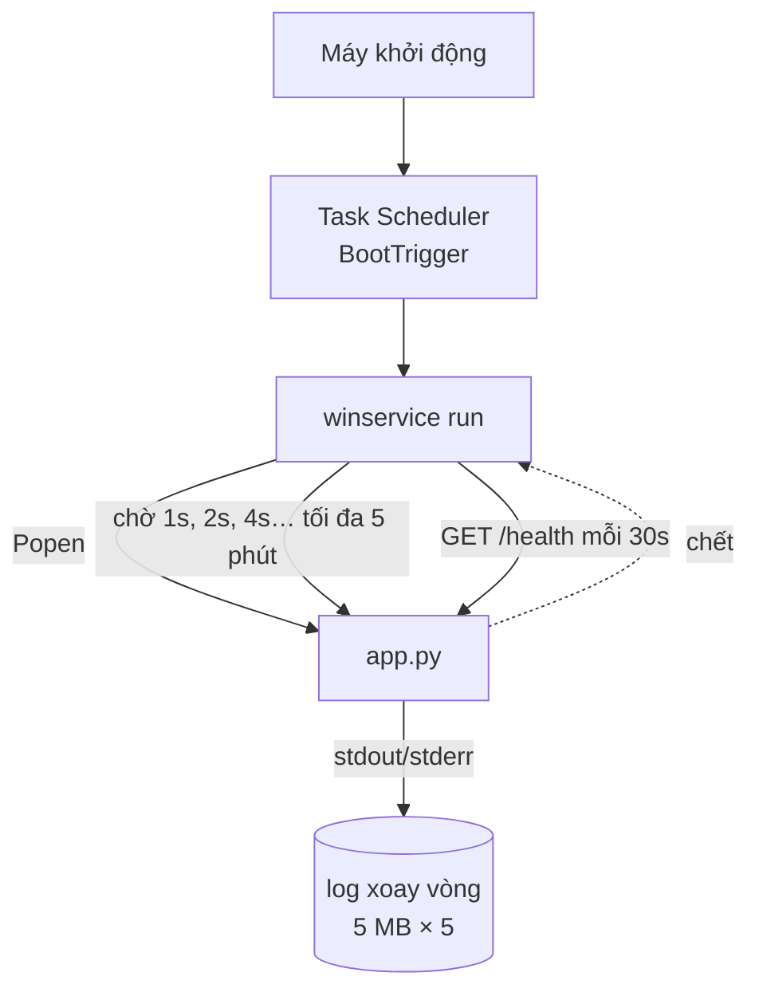

# win-service-kit

[](https://github.com/ferbdev-byte/win-service-kit/actions/workflows/ci.yml)


Biến một script bất kỳ (Python, Node, `.exe`) thành dịch vụ chạy **24/24** trên Windows: tự khởi động cùng máy, tự bật lại khi chết, ghi log xoay vòng, kiểm tra sức khoẻ qua HTTP. Không cần pywin32, không cần NSSM, không cần quyền viết Windows Service.

> Tách ra từ cách mình cho máy chủ nội bộ của công ty chạy liên tục không cần ai trông.



## Tính năng

- **Bật lại có tính toán**: chờ tăng dần 1s → 2s → 4s… (tối đa 5 phút); chạy ổn hơn 60s thì đặt lại. Chết quá 10 lần trong 10 phút thì dừng hẳn, không quay vòng đốt CPU.
- **Log xoay vòng**: gom stdout/stderr của ứng dụng vào một file, tự cắt ở 5 MB, giữ 5 file.
- **Kiểm tra sức khoẻ**: `--health-url` — ứng dụng treo (còn chạy nhưng không trả lời) cũng được khởi động lại.
- **Cài một lệnh**: sinh XML Task Scheduler (khởi động không giới hạn thời gian, chạy cả khi đang dùng pin, tự chạy lại khi lỗi) và cài bằng `schtasks`.
- **Chạy dưới tài khoản người dùng** khi cần (giữ được ổ mạng, cấu hình rclone, đăng nhập Google), không lưu mật khẩu (S4U).

## Cài đặt

```powershell
pip install git+https://github.com/ferbdev-byte/win-service-kit
```

## Dùng

```powershell
# Chạy thử ở terminal
winservice run --log C:\Logs\app.log -- python C:\App\server.py

# Có kiểm tra sức khoẻ
winservice run --health-url http://127.0.0.1:8765/api/ping -- python server.py

# Cài để tự chạy khi máy khởi động (PowerShell chạy quyền Admin)
winservice install --name "MayChu\WebNoiBo" --cwd C:\App --log C:\Logs\web.log -- python server.py

# Chạy khi người dùng đăng nhập, dưới tài khoản của họ
winservice install --name "MayChu\DongBo" --user MAYCHU\admin --at-logon -- winsync watch -c C:\cfg.json

winservice status --name "MayChu\WebNoiBo"
winservice uninstall --name "MayChu\WebNoiBo"

# Chỉ xem XML sẽ cài
winservice xml --name Demo -- python app.py
```

Đi cùng: [win-file-sync](https://github.com/ferbdev-byte/win-file-sync) và [dual-backup](https://github.com/ferbdev-byte/dual-backup).

## Vì sao Task Scheduler mà không phải Windows Service?

| | Windows Service | Task Scheduler + winservice |
|---|---|---|
| Cần viết code service (pywin32) | Có | Không |
| Chạy dưới tài khoản người dùng, giữ cấu hình của họ | Rắc rối | Dễ |
| Tự bật lại khi chết | Có | Có, kèm backoff và giới hạn |
| Log stdout/stderr | Tự làm | Có sẵn |

## Dùng như thư viện

```python
from winservice import Supervisor, Backoff

Supervisor(["python", "app.py"], log_file="app.log", backoff=Backoff(max_restarts=5)).run()
```

## Phát triển

```powershell
pip install -e ".[dev]"
ruff check .
pytest
```

## Giấy phép

MIT
